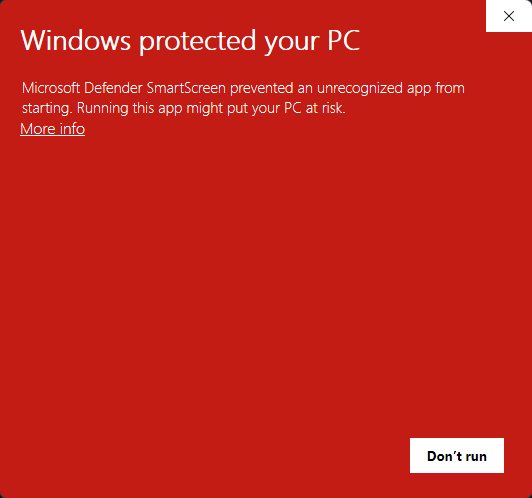
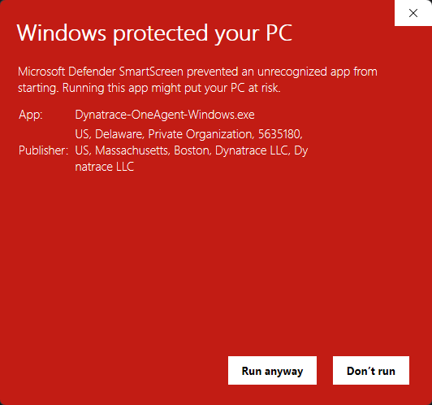
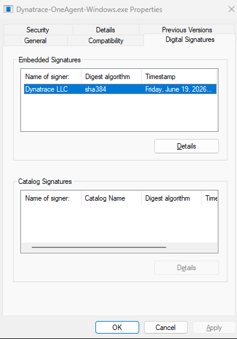
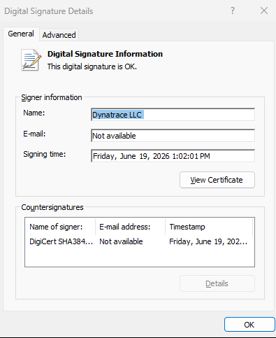

# "Windows protected your PC": guidance for end users

## What you are seeing

When you run a freshly released dtwiz version on Windows, you may get a large dialog headed
**Windows protected your PC**:

{ width="420" }

There is no obvious way to continue. The only button is **Don't run**, and the option to continue
is hidden behind the **More info** link.

Select **More info** and the dialog expands to name the file and who signed it:

{ width="420" }

> **The colour is not a severity level.** This dialog is tinted with your Windows accent colour:
> blue on a default installation, and whatever you or your IT department configured otherwise. Your
> dialog may therefore be a different colour than the screenshots on this page, which were taken on
> a machine with a red accent. Red here does not mean "worse".

---

## What to do

1. Select **More info**.
2. Check the **Publisher** line. For a genuine Dynatrace binary it reads:

   ```text
   US, Delaware, Private Organization, 5635180, US, Massachusetts, Boston, Dynatrace LLC, Dynatrace LLC
   ```

   The important part is **`Dynatrace LLC`**. The rest is the company's registered legal identity,
   which is included because Dynatrace uses an Extended Validation code-signing certificate.

3. Check the **App** line names the file you downloaded.
4. **Verify the file before you continue.** Leave this dialog as it is, or select **Don't run** to
   dismiss it, and work through at least one of the checks in
   [Verify the file before you run it](#verify-the-file-before-you-run-it) below. The
   **Publisher** line alone is a good first signal, but the checks below read the signature
   directly and tell you whether the bytes on your disk are intact.
5. Only once a check has come back clean, select **Run anyway**. If you dismissed the dialog,
   start the installer again and select **More info**, then **Run anyway**.
6. If the **Publisher** says **Unknown publisher**, names a different company, or the line is
   missing entirely, select **Don't run** and contact Dynatrace support. Do not run the file.

> **Do not select "Run anyway" as the first thing you do.** The button is the last step, not the
> first. Everything you need in order to decide is available before you press it, and none of it
> requires running the file.
>
> **You are not on a timer.** Selecting **Don't run** cancels the launch and changes nothing. You
> can verify the file and start the installer again afterwards, as many times as you like.
>
> **No "Run anyway" button?** Some organisations configure Windows to forbid overriding
> SmartScreen. If your IT policy does that, the button is hidden by design and you need your IT
> department to deploy the installer for you.

---

## Verify the file before you run it

You can do all of this **before** running anything. Any one of these checks is enough, because
they all read the same signature.

### 1. The publisher line in the warning

The quickest check, and the one most people can do. A correct `Dynatrace LLC` publisher means
Windows verified a valid Dynatrace signature on the exact bytes on your disk. **Unknown
publisher** means it did not, so stop there.

### 2. File properties, no tools required

Right-click the downloaded file, choose **Properties**, and open the **Digital Signatures** tab:

{ width="380" }

You should see one entry under **Embedded Signatures** with **Name of signer: Dynatrace LLC** and
a **Timestamp**. Select that row, then choose **Details**:

{ width="380" }

The line that matters is **"This digital signature is OK."** Also check:

- **Name** is `Dynatrace LLC`.
- **Signing time** is present, and a **DigiCert** entry is listed under
  **Countersignatures**. That is a trusted timestamp. It proves when the file was signed, and it
  is why the signature stays valid after the signing certificate eventually expires.
- **Digest algorithm** reads `sha384`.
- **View Certificate** opens the certificate itself. It should report _"This certificate is OK"_
  and chain up to a DigiCert root.

If this dialog instead says the signature is **not OK**, or the file has no **Digital Signatures**
tab at all, the file is not a genuine, intact Dynatrace binary. Delete it and download again from
an official source.

### 3. PowerShell, one command

```powershell
Get-AuthenticodeSignature .\dtwiz.exe | Format-List Status, StatusMessage, SignerCertificate
```

For more detail, including the exact certificate fingerprint:

```powershell
$sig = Get-AuthenticodeSignature .\dtwiz.exe
$sig.Status
$sig.SignerCertificate.Subject
$sig.SignerCertificate.Thumbprint
$sig.TimeStamperCertificate.Subject
```

`Status` must be **`Valid`**. The subject must contain `CN=Dynatrace LLC`. What the other values
mean:

| `Status`       | Meaning                                                                  |
| -------------- | ------------------------------------------------------------------------ |
| `Valid`        | Signature is intact and chains to a trusted root. This is what you want. |
| `NotSigned`    | No signature at all. Not a released Dynatrace binary.                    |
| `HashMismatch` | **The file was modified after it was signed.** Do not run it.            |
| `NotTrusted`   | Signed, but the chain does not reach a root your machine trusts.         |
| `UnknownError` | Usually a corrupt download. Download again.                              |

Two further values exist, `NotSupportedFileFormat` and `Incompatible`. Both mean Windows could not
evaluate a signature on that file at all, rather than that a signature failed. Check you are
pointing the command at the file you downloaded.

### 4. signtool, if you have the Windows SDK

```powershell
signtool.exe verify /pa /v dtwiz.exe
```

This prints the full certificate chain and the timestamp, and exits non-zero on any failure, so
it also works inside a deployment pipeline.

### 5. Compare the checksum

If the download page publishes a SHA-256 checksum for the file, compare it:

```powershell
Get-FileHash .\dtwiz.exe -Algorithm SHA256
```

### And: get the file from an official source

Signature checks tell you a file is genuine and unmodified. They cannot tell you that the _version_
you were pointed at was the right one. Download Dynatrace software only from your Dynatrace
environment or an official Dynatrace URL, not from a mirror, a file-sharing link, or a search
result.

---

## What a genuine Dynatrace signature looks like

| Field            | Expected value                                                               |
| ---------------- | ---------------------------------------------------------------------------- |
| Subject          | `CN=Dynatrace LLC`, `O=Dynatrace LLC`, `L=Boston`, `S=Massachusetts`, `C=US` |
| Certificate type | Extended Validation (EV), business category _Private Organization_           |
| Issuer           | DigiCert                                                                     |
| Digest algorithm | `sha384`                                                                     |
| Timestamp        | Present, countersigned by DigiCert                                           |

> **These details change when Dynatrace renews its certificate**, which happens roughly yearly.
> The stable facts are the subject organisation **`Dynatrace LLC`** and a **DigiCert** issuer. A
> signature that verifies as OK with that publisher is genuine even if the issuing CA name or the
> serial number differs from this table.

---

## Why the warning appears

**It is not a virus alert, and it does not mean the file is damaged or tampered with.**

Microsoft Defender SmartScreen shows this dialog when a program has no established _reputation_
yet. Reputation is a measure of how widely a program has been seen and run before, essentially
download history. It is not an analysis of what the program does.

SmartScreen builds that reputation against two things: the certificate the program was signed
with, and the program file's own fingerprint. Dynatrace has recently renewed its Windows
code-signing certificate. To SmartScreen a new certificate is a new identity, so the reputation
earned by earlier releases does not carry over. It rebuilds automatically as the new releases are
downloaded and installed by more people, and the warning stops appearing on its own.

Microsoft applies this to every software publisher. There is no way to pay for, request, or
pre-register reputation.

Two things this warning specifically does **not** mean:

- **It is not a malware detection.** Microsoft Defender Antivirus scans files separately. If
  Defender had actually found something, you would get a different message, a threat notification
  naming the malware, not this one.
- **It is not an invalid or missing signature.** Windows read the digital signature, validated it,
  and trusted it enough to display the company's legal identity. That is precisely why the
  **Publisher** line is filled in. An unsigned or tampered file shows **Unknown publisher**.

---

## Deploying to many machines

The warning is triggered by the _Mark of the Web_, a tag Windows attaches to files that came from
the internet. That has practical consequences for rollouts:

- **Silent and scripted installations usually never see this dialog.** A file downloaded by a
  script or a deployment tool generally carries no Mark of the Web, so no reputation check runs.
  If you deploy through Intune, SCCM, Ansible, or your own scripts, you are very unlikely to be
  affected at all.
- **After verifying the signature**, IT can clear the marker on a file so the check is skipped:
  **Properties → General → Unblock**, or in PowerShell:

  ```powershell
  Unblock-File .\dtwiz.exe
  ```

- **For an internal distribution share or web server**, adding that host to the _Local intranet_
  zone via Group Policy stops the marker being applied in the first place, for every file you
  distribute.

> **Verify the signature before you unblock anything.** Removing the Mark of the Web disables the
> reputation check for that file. It is the right move for a file you have already verified, and
> the wrong move as a blanket habit.

---

## When you should not run the file

Stop and contact Dynatrace support if any of these are true:

- The **Publisher** is `Unknown publisher`, blank, or names a company other than `Dynatrace LLC`.
- `Get-AuthenticodeSignature` reports **`HashMismatch`**, meaning the file was altered after
  signing.
- The **Digital Signatures** tab is missing, or the details dialog does not say the signature
  is OK.
- You did not download the file from your Dynatrace environment or an official Dynatrace URL.
- Defender reports an actual threat, rather than this reputation warning.
